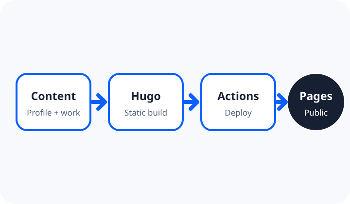

## 활동 개요

- **수행 기간:** 2026년 10월
- **상태:** 진행 중 — 공개 배포와 최종 보고서 검증 단계
- **형태:** 초급프로젝트 과제, 개인 수행

## 해결하려 한 문제

기존 개인 홈페이지를 변경하지 않으면서도, 수업에서 요구한 Hugo 테마·GitHub Actions 자동 배포·반응형·접근성·Git 이력 조건을 독립적으로 충족하는 새 포트폴리오가 필요했습니다.

## 나의 역할과 기여 범위

개인 프로젝트로 진행했습니다. 테마 선택, 정보 구조 설계, Hugo 설정, 콘텐츠 작성, GitHub Actions 구성, 반응형·키보드 검증, 보고서 근거 정리를 직접 담당했습니다. 원본 테마 코드는 출처와 라이선스를 유지해 포함했습니다.

## 수행 과정과 선택 이유

1. 공개 채점 기준을 배포·경로·메뉴·반응형·접근성·Git·콘텐츠·보고서 영역으로 나눴습니다.
2. `hugo-blog-awesome`을 선택했습니다. 기본 구조가 단순하고 반응형 메뉴, 다크 모드, 목차, 맨 위로 이동을 제공해 콘텐츠와 검증에 집중할 수 있기 때문입니다.
3. 저장소 하위 경로에서도 자산 URL이 정상 생성되도록 운영 `baseURL`을 명시했습니다.
4. 기능 단위로 커밋하고, production 빌드와 화면 폭별 점검 뒤 개선 사항을 다시 커밋했습니다.

## 산출물과 결과

주요 산출물은 Hugo 소스, GitHub Actions 워크플로, 공개 GitHub Pages 사이트, 빌드·링크·반응형·키보드 검증 기록입니다. `main` push가 자동으로 production 빌드와 Pages 배포를 실행하도록 구성했습니다.

## 배운 점과 한계

정적 사이트도 로컬 루트 경로에서만 확인하면 배포 하위 경로의 자산 오류를 놓칠 수 있다는 점을 배웠습니다. 또한 기능 수보다 실제 링크·키보드·화면 폭을 직접 검증하고 근거를 남기는 과정이 중요했습니다.

현재 한계는 원격 저장소와 Actions가 생성된 뒤에만 실제 HTTPS 배포 성공을 확정할 수 있다는 점입니다.

## 다음 개선 방향

새 저장소를 공개한 뒤 Actions 실행 URL과 최종 SHA를 보고서에 연결하고, Chrome의 1440px·768px·390px 화면과 연속 키보드 조작을 다시 확인하겠습니다. 이후 Lighthouse 접근성 결과도 참고 자료로 추가할 계획입니다.

